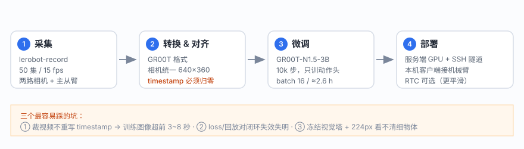
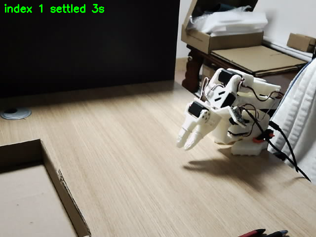
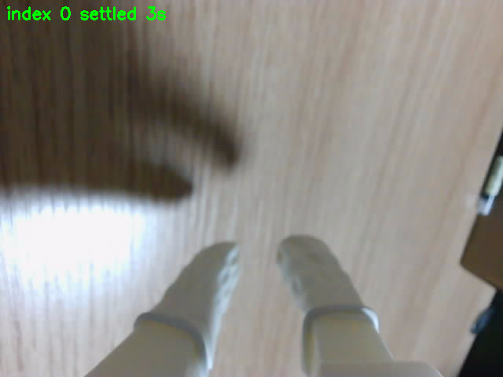
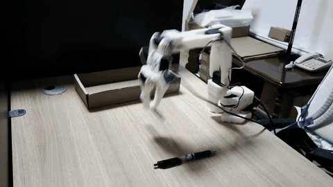
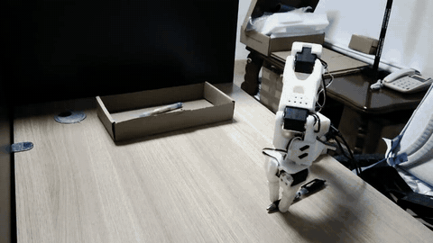
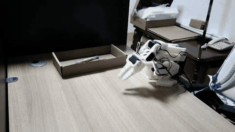
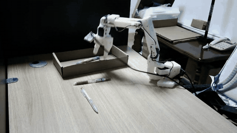

# SO101-GR00T

> 用 **NVIDIA GR00T N1.5** 在 **SO-101** 机械臂上做桌面操作任务：从数据采集、格式转换、
> 微调训练到真机部署的完整记录，包含两个已经跑通的模型和一堆踩过的坑。

<p align="center">
  
</p>

<p align="center">
  <a href="docs/01_INSTALL.md">安装</a> ·
  <a href="docs/02_DATA_COLLECTION.md">采集</a> ·
  <a href="docs/04_TRAINING.md">训练</a> ·
  <a href="docs/05_DEPLOYMENT.md">部署</a> ·
  <a href="docs/08_LESSONS.md">踩坑记录</a>
</p>

---

## 项目效果

两个任务，同一套硬件、同一套流程，第二个任务暴露了第一个任务里发现不了的数据 bug。

| | **v1 · 抓单支笔** | **v3 · 桌面全物体** |
|---|---|---|
| 任务文本 | `Pick up a pen and put it into the box` | `Put all the objects on the table into the box` |
| 数据集 | 50 集 / 17,789 帧 / 15 fps | 102 集 / 51,209 帧 / 15 fps |
| 训练步数 | 10,000（≈9 epoch） | 30,000（≈9.4 epoch） |
| batch | 16 | 16 |
| 可训参数 | ≈0.75B（动作头 + projector） | 同左 |
| 训练时长 | ≈2.6 h（4090 / 4080S） | 6.3 h（4080S 32G） |
| 最终 train_loss | — | 0.08 |
| 权重 | `groot_arm101_pick_one_pen_v1` | `BACKUP_gr00t_all_objects_v3` |

> v1 能稳定把笔抓起来放进盒子；v3 在真机上抓空 —— 排查后发现**不是模型能力问题，
> 而是数据预处理把视频裁了却忘了把 `timestamp` 归零**，导致训练时每帧图像都超前 3~8 秒。
> 完整分析见 [docs/08_LESSONS.md](docs/08_LESSONS.md)。

两个模型都**只训练动作头**，视觉塔（SigLIP2）与语言模型（Qwen3-1.7B）全程冻结。

<p align="center">
  
  <br/>
  <sub>左：前视 640×360（index 1） ｜ 右：腕部 1280×720（index 0，训练前缩到 360p）</sub>
</p>

<p align="center">
  ▶ <a href="media/demo_80s.mp4"><b>完整真机演示 · 80 秒 · 640×360 · 6.4 MB</b></a><br/>
  <sub>v3 权重 + RTC 客户端实录：从停靠位姿起跑 → 找物 → 合爪 → 搬运</sub>
</p>

<table align="center">
  <tr>
    <td align="center"><br/><sub>0:08 — 起步 / 伸出</sub></td>
    <td align="center"><br/><sub>0:26 — 接近目标</sub></td>
  </tr>
  <tr>
    <td align="center"><br/><sub>0:34 — 抓取动作最密的一段</sub></td>
    <td align="center"><br/><sub>0:50 — 搬运 / 放置</sub></td>
  </tr>
</table>

---

## 硬件

| 部件 | 型号 / 配置 | 备注 |
|---|---|---|
| 机械臂 | SO-101 follower（**COM3**，12 V 供电） | 6 个舵机，1 Mbps，protocol 0 |
| 主臂 | SO-101 leader（**COM4**，USB 5 V） | 电压特征可用于区分主从 |
| 前视相机 | index **1**（USB，原生支持 640×360） | 训练与推理都用 640×360 |
| 腕部相机 | index **0**（USB，只支持 640×480 / 1280×720） | 采集 720p，训练前缩到 360p |
| 训练 GPU | RTX 4080S 32 G / 4090 24 G | batch 16 占 24.4 G |

## 软件

| 组件 | 版本 | 说明 |
|---|---|---|
| [LeRobot](https://github.com/huggingface/lerobot) | 0.6.2 | 采集、回放、数据集格式 |
| [Isaac-GR00T](https://github.com/NVIDIA/Isaac-GR00T) | N1.5 | 微调与策略服务 |
| torch | 2.5.1 + cu124 | |
| av | **必须 12.3.0** | 高版本 `frame.pts=None` 会让 mp4 mux 报 Errno 22 |
| flash-attn | 2.7.4.post1 | 需按 torch 版本编译 |
| 客户端 | Windows + Python 3.13 | 只跑相机与串口，不需要 GPU |

---

## 快速开始

```
①  采集              ②  转换                ③  训练              ④  服务            ⑤  推理
lerobot-record  →  85_lerobot_v30_to_gr00t  →  94_train_gr00t  →  100_policy_server  →  run_groot_official
                   91_fix_stats                (30k steps)         (远端 GPU)            (本机接机械臂)
                   92_equalize_cameras
```

**1) 采集**（本机）

```bash
lerobot-record \
  --robot.type=so101_follower --robot.port=COM3 --robot.id=my_awesome_follower_arm \
  --robot.cameras="{ front: {type: opencv, index_or_path: 1, width: 640, height: 360, fps: 15}, wrist: {type: opencv, index_or_path: 0, width: 1280, height: 720, fps: 15} }" \
  --teleop.type=so101_leader --teleop.port=COM4 --teleop.id=my_awesome_leader_arm \
  --dataset.repo_id=local/arm101_pick_one_pen \
  --dataset.single_task="Pick up a pen and put it into the box" \
  --dataset.fps=15 --dataset.episode_time_s=40 --dataset.reset_time_s=8 \
  --dataset.num_episodes=50 --dataset.push_to_hub=false
```

**2) 转换 + 对齐**（本机或服务器均可）

```bash
python scripts/data/85_lerobot_v30_to_gr00t.py --src <raw> --dst <gr00t_ds> \
  --modality examples/so100_dualcam__modality.json
python scripts/data/91_fix_stats.py      <gr00t_ds>
python scripts/data/92_equalize_cameras.py <gr00t_ds> --target 640x360 --crf 18
```

**3) 训练**（GPU 机器，6 小时量级）

```bash
DS=/root/gr00t_data/arm101_pick_one_pen OUT=/root/autodl-tmp/gr00t_v1 \
STEPS=10000 SAVE=2000 BATCH=16 bash scripts/train/94_train_gr00t_official.sh
```

**4) 起策略服务**（GPU 机器）

```bash
python scripts/deploy/100_policy_server_jpeg.py \
  --model-path /root/autodl-tmp/gr00t_v1 --port 5555
```

**5) 本机推理**（两个窗口）

```bash
# 窗口 A：隧道
python scripts/deploy/ssh_tunnel.py --local 5555 --remote 127.0.0.1:5555

# 窗口 B：客户端
python scripts/deploy/run_groot_official.py --steps 800 --record-video outputs/run1.mp4
```

> 想要更平滑的动作，用 RTC 版客户端：`scripts/deploy/run_groot_rtc.py`（见 [docs/06_RTC.md](docs/06_RTC.md)）。

---

## 目录结构

```
.
├── docs/                    # 教程与踩坑记录（建议按顺序读）
├── examples/                # 连接配置、modality 模板、一键启动脚本
├── media/                   # README 用的图
└── scripts/
    ├── data/                # 数据集转换 / 统一 / 裁剪 / 体检
    ├── train/               # 环境安装 + 训练启动 + 权重备份
    ├── deploy/              # 策略服务端 + 本机客户端 + SSH 隧道
    ├── diagnose/            # 回放、增益、散布、视觉消融等诊断脚本
    └── tools/               # 上传下载、训练面板、相机与串口探测
```

## 文档

| 文档 | 内容 |
|---|---|
| [01_INSTALL.md](docs/01_INSTALL.md) | 两端环境：Windows 客户端 + Linux GPU 服务端（含 flash-attn / av 版本坑） |
| [02_DATA_COLLECTION.md](docs/02_DATA_COLLECTION.md) | 采集协议、相机与串口确认、参数对齐表 |
| [03_DATA_PIPELINE.md](docs/03_DATA_PIPELINE.md) | raw → GR00T 格式五步流水线，**含 timestamp 错位这个致命 bug** |
| [04_TRAINING.md](docs/04_TRAINING.md) | 微调配方、显存估算、ckpt 保存策略 |
| [05_DEPLOYMENT.md](docs/05_DEPLOYMENT.md) | 策略服务 + SSH 隧道 + 客户端，含全部参数说明 |
| [06_RTC.md](docs/06_RTC.md) | 实时分块（RTC）推理：论文版软引导实现 |
| [07_DIAGNOSTICS.md](docs/07_DIAGNOSTICS.md) | 8 个诊断脚本各测什么、怎么读结果 |
| [08_LESSONS.md](docs/08_LESSONS.md) | **最有价值的一篇**：三个把项目带偏的判断错误 |
| [MODELS.md](docs/MODELS.md) | 两个模型的权重、数据、指标与对应关系 |

---

## 三条最重要的经验

**1. 裁了视频，必须重写 `timestamp`。**
GR00T 取帧是 `argmin|视频帧时间 − parquet里写的timestamp|`。如果裁剪脚本只 `df.iloc[n:]`
而不把 `timestamp` 归零，训练时每一帧图像都会超前 `n/15` 秒。这个错误**不会**在 loss、
回放、单步误差上暴露，只会在真机上崩。👉 [03_DATA_PIPELINE.md](docs/03_DATA_PIPELINE.md)

**2. loss / 回放 / 单步误差，对闭环失效是结构性失明的。**
它们全是 teacher-forced 指标：每一步都喂真值把误差锚死。模型完全可以"看未来的画面"把 loss 拟合到 0.01，
而闭环一步都走不对。能测闭环性质的只有雅可比增益（`122`）和输出散布比（`126`），
真正的终审只能是真机日志。👉 [08_LESSONS.md](docs/08_LESSONS.md)

**3. 冻结视觉塔 + 224×224 输入，细物体注定看不清。**
640×360 被各向异性缩到 224×224，最后每个视觉 token 覆盖原图约 **38×21 像素**。
一支 25 px 宽的笔正好落在一个 token 里 —— 模型"知道那儿有东西"，但不知道它偏左还是偏右 2 mm。
这不是调参能解决的，要靠相机推近或改输入分辨率。👉 [08_LESSONS.md](docs/08_LESSONS.md)

---

## 已知限制

- 演示数据里**没有失败恢复样本**（439 次合爪，0 次重试），所以模型抓空之后永远回不来。
  真机部署必须自己加兜底：合爪后夹爪读数 < 3 就抬起重试。
- 单目 640×360 对毫米级对位任务（插吸管、插销）精度不够，需要更近的视角或更高分辨率。
- 两个模型都只训动作头；没有试过解冻视觉塔的大规模微调。
- 采集时臂的起始位姿若贴近关节极限（如 `shoulder_lift` 压到 −104°），模型会输出"继续下压"，
  物理上被桌面顶住 ⇒ 表现为"启动后不动"。客户端启动位姿要抬高 10°。

## 未来工作

- [ ] 采集阶段加入随机初始位姿 + 失败恢复演示（DAgger）
- [ ] 视觉侧：裁到工作区并做正方形输入，让目标物体跨 4 个 token
- [ ] state-relative action 表征（官方推荐，比绝对动作更容易收敛）
- [ ] 两阶段策略：先"抓"，再"放"，用统一 home 位姿切分

## 致谢

- [NVIDIA Isaac-GR00T](https://github.com/NVIDIA/Isaac-GR00T) —— GR00T N1.5 基座与训练框架
- [HuggingFace LeRobot](https://github.com/huggingface/lerobot) —— SO-101 驱动、数据集格式、遥操作
- [Lee-LEO-H/Lerobot-GR00TN1.5](https://github.com/Lee-LEO-H/Lerobot-GR00TN1.5) —— 本仓库的文档组织参考

## License

[MIT](LICENSE)
